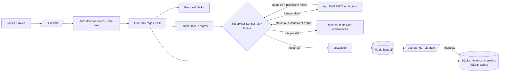

# Getnet Support Agents

Sistema multiagente que atende lojistas da Getnet num único `POST /chat` (pt ou en): o Router classifica a mensagem, o Knowledge Agent responde com RAG sobre o site oficial da Getnet (ou busca web para assunto geral), o Customer Support Agent consulta os dados do próprio lojista por ferramentas com confirmação, e o Human Escalation Agent leva ao operador o que não tem fonte ou confiança. Métrica de negócio: resolução automática sem número inventado.

| | |
|---|---|
| Rodar | `docker compose up -d --build` → `http://localhost:8000/docs` · console do operador em `/operator` |
| Testar | `python scripts/check.py --docker --scale` (lint, testes, eval com gate, build, imagem sem extras, smoke do container, 2 réplicas atrás de balanceador) |
| CI | [`.github/workflows/ci.yml`](.github/workflows/ci.yml): lint, testes, eval offline com gate, build, smoke do container e 2 réplicas; o último run verde fica na aba Actions do repositório |
| Vídeo | [walkthrough na página de Releases](../../releases/tag/video) (MP4 + legendas; narração por IA a partir do roteiro do autor, telas e números reais) |

## 0. Para quem avalia em 5 minutos

| Minuto | O quê | Comando / onde |
|---|---|---|
| 1 | subir e perguntar (payload literal do enunciado) | `docker compose up -d --build` e o `curl` da §1 |
| 2 | conferir que tudo passa, do lint ao container | `python scripts/check.py --docker` (CI: link no topo) |
| 3 | números, todos gerados do `evals/results/` commitado | §5 (offline com gate, ao vivo com pass^3, juiz calibrado, replanejamento com × sem, matriz de confusão) |
| 4 | onde cada critério da régua está provado, e o limite de cada um | §3 (o `check.py` reprova prova citada que falha) |
| 5 | o que é kit e o que foi feito no relógio | §8 e `git log` |

## 1. Como rodar

```bash
cp .env.example .env                      # opcional: sem chave roda no modo offline determinístico
docker compose up -d --build                # o compose já liga AUTH_MODE=demo (payload literal)
curl -s localhost:8000/health

# 1) payload LITERAL do enunciado (AUTH_MODE=demo: user_id do corpo; a resposta marca identity_verified=false)
curl -s -X POST localhost:8000/chat -H "Content-Type: application/json" \
     -d '{"message":"When will the money from yesterday'"'"'s sales be deposited?","user_id":"cliente1988"}'

# 2) com identidade verificada (JWT assinado para o lojista cliente1988 do CRM fictício)
TOKEN=$(docker compose exec -T api python -m app.auth cliente1988)
curl -s -X POST localhost:8000/chat -H "Authorization: Bearer $TOKEN" \
     -H "Content-Type: application/json" -d '{"message":"Minha maquininha não conecta na internet, o que faço?"}'
```

**Testar tudo** (lint, testes, eval offline com gate, build, smoke do container, 2 réplicas atrás de
balanceador): `python scripts/check.py --docker --scale`. Sem Docker: `python scripts/check.py`.

- **Identidade:** `AUTH_MODE=required` (só Bearer) ou `demo` (aceita `user_id` do corpo, marca
  `identity_verified=false`, rate limit por IP). Decisão em [docs/adr/0001-auth-mode-demo.md](docs/adr/0001-auth-mode-demo.md).
- **Operador humano:** `/operator` (token digitado na página, nunca embutido), `GET /handoffs`,
  `POST /handoffs/{id}/reply` com `X-Operator-Token`. A resposta entra na conversa do cliente e o
  próximo turno já a enxerga. Opcional: Telegram (`TELEGRAM_*` no `.env`) avisa o caso e aceita
  `/responder T-xxxx texto` pelo webhook `/telegram/webhook`.
- **Ao vivo:** `powershell -File scripts/live_eval.ps1 -MaxUsd 3` (eval por split com teto de US$,
  juiz e README). Extras opcionais fora da imagem: `.[hybrid]` (busca híbrida) e `.[otel]` (OpenTelemetry).

## 2. Arquitetura



**Por que essa divisão:** uma fonte de verdade por agente, e um contrato só entre eles (`AgentResult` com
`status` `ok`/`insufficient`/`error`, em `src/app/schemas.py`). Quem lê o status e replaneja é o supervisor;
nenhum agente chama outro. Três diagramas (turno, RAG, HITL) em [docs/ARCHITECTURE.md](docs/ARCHITECTURE.md);
operação em [docs/OBSERVABILITY.md](docs/OBSERVABILITY.md) e [docs/RUNBOOK.md](docs/RUNBOOK.md).

### Agente do enunciado → nome no código → fonte de verdade

| Agente do enunciado | Nome no código | Fonte de verdade | Arquivo |
|---|---|---|---|
| Router Agent (entrada; "manages the workflow and data flow") | `router` + `supervisor` | taxonomia e planos do domínio (`PLANS`, `FALLBACK`, `ALLOWED`, `DEPENDS`, `NO_ESCALATION`) | `src/app/router.py`, `src/app/supervisor.py`, `src/app/domain/challenge/flow.py` |
| Knowledge Agent | `faq` | site da Getnet indexado (RAG); busca web só para `general` | `src/app/agents.py`, `src/app/rag.py`, `src/app/ingest.py` |
| Customer Support Agent | `records` | CRM fictício do lojista, só por ferramentas, com identidade do servidor | `src/app/agents.py`, `src/app/domain/challenge/tools.py`, `src/app/actions.py` |
| Human Escalation Agent (bônus) | `escalation` | fila de handoff persistida no SQLite + operador | `src/app/agents.py`, `src/app/store.py`, `src/app/resume.py` |

`faq`/`records` são o contrato do kit (`schemas.AgentName`); a documentação e as respostas usam os nomes do enunciado.

### Taxonomia de intenções ([docs/SPEC.md](docs/SPEC.md); o Router devolve exatamente uma)

| Intent | Quando | Plano inicial | Se falhar |
|---|---|---|---|
| `knowledge` | como funciona produto, serviço, tarifa ou regra da Getnet, sem dado do lojista | Knowledge | sem fonte → humano |
| `support` | dado do próprio lojista: vendas, recebimentos, saldo, antecipação dele, contestação dele | Customer Support | erro de tool → Knowledge → humano |
| `troubleshoot` | sintoma na maquininha ou numa transação (não conecta, erro, recusa, travou) | Customer Support → Knowledge | humano |
| `general` | fora da Getnet e respondível pela web (clima, câmbio, notícia) | Knowledge com busca web | nunca escala: sem web, diz que não sabe |
| `multi` | duas perguntas de intenções diferentes | união ordenada, em paralelo quando independentes | conforme cada parte |
| `human_request` | pede atendente | Human Escalation | — |
| `blocked` | guardrail barrou (injeção, jailbreak, dado de terceiro, abuso) | — | recusa padrão |

**Desempates (da SPEC):** sintoma ("não conecta", "erro", "recusada", "travou") → `troubleshoot`, mesmo com
"minha maquininha"; pedido de dado ("quando cai", "quanto vendi", "meu saldo", "antecipar o meu valor") →
`support`; "preciso de / como funciona / posso" sobre produto, sem pedir dado do lojista → `knowledge` (AC-04,
"Do I need a bank account to receive my sales via Pix?"); produto que a Getnet não tem ou outro banco →
`knowledge` (o RAG não acha → humano), não `general`.

### Fluxo de uma mensagem

| Etapa | Arquivo | Usa LLM? |
|---|---|---|
| Autenticação (`AUTH_MODE` required/demo) e rate limit | `src/app/api.py`, `src/app/auth.py` | não |
| Guardrail de entrada: regex, desofuscação, máscara de PII | `src/app/guardrails.py` | não |
| Guardrail semântico (injeção, jailbreak, abuso) | `src/app/guardrails.py` | sim (Haiku); sem LLM fica o regex |
| Router: intenção, idioma, confiança, plano | `src/app/router.py`, `src/app/domain/challenge/flow.py` | sim (Haiku com JSON schema e few-shot); offline: regras + k-NN |
| Supervisor: executa o plano, lê o status, replaneja | `src/app/supervisor.py` | sim (agentes como tools); fallback na tabela determinística |
| Knowledge: busca, rerank, redação com citação `[n]` | `src/app/agents.py`, `src/app/rag.py` | busca não; rerank e redação sim |
| Customer Support: ferramentas sobre o CRM | `src/app/agents.py`, `src/app/domain/challenge/tools.py` | escolha e redação sim; execução e identidade não |
| Ação de escrita: confirmação do dono, quatro olhos se `high` | `src/app/actions.py` | não |
| Checagem numérica e flags de risco | `src/app/grounding.py` | não (todo turno) |
| Human Escalation, fila, retomada | `src/app/agents.py`, `src/app/store.py`, `src/app/resume.py` | só a redação da retomada |
| Log JSON, métricas, custo, trace | `src/app/observability.py`, `src/app/analytics.py` | não |

### RAG: ingestão → armazenamento → busca → geração

1. **Ingestão** (`python -m app.ingest`, `src/app/ingest.py`): lê `data/sources.json` com duas fontes,
   `www.getnet.net/en` (a indicada no enunciado) e `site.getnet.com.br` (onde estão Get Clássica, Get Smart,
   crediário e Link de Pagamento); baixa só hosts de `allowed_hosts`, tira menu, rodapé e script, e corta em
   trechos com título, URL e data de coleta.
2. **Armazenamento:** trechos em JSONL no diretório de dados, versionados no git; documento com instrução
   embutida é descartado na carga (`poisoned_docs_dropped_total`).
3. **Busca** (`src/app/rag.py`): BM25 com título em peso 2 e glossário pt↔en (`data/glossary.json`, ex.:
   "antecipação" ↔ "advance"); `RETRIEVER=hybrid` soma embeddings por RRF (extra `.[hybrid]`); com LLM o Haiku
   reordena o top-20 (`RERANK`) e, se falhar, fica a ordem do BM25 (`rerank_fallback_total`).
4. **Geração** (`src/app/agents.py`): o Knowledge Agent redige só com os trechos, citando `[n]`; abaixo do limiar
   de cobertura (`COVERAGE_MIN_SCORE`, escolhido por medida no eval) devolve `insufficient` e o supervisor
   escala. **Sem fonte, sem afirmação.**

### Como usamos LLM, e onde não

Usamos: guardrail semântico, Router, supervisor, rerank, redação do Knowledge e do Customer Support, retomada
após o operador e juiz do eval (fora do caminho da resposta). **Não usamos** (determinístico, testável, sem
custo): identidade (vem do token), autorização e execução de ferramentas, confirmação e quatro olhos, checagem
de número contra fonte, máscara de PII, rate limit, fallback do supervisor, métricas e custo. Sem chave
(`LLM_PROVIDER=offline`) tudo roda pelo caminho determinístico, que é o que o CI mede.

## 3. Cobertura da régua de avaliação

Mapa para quem avalia **lendo**: código, teste que prova e onde está o número. Os números vêm dos
blocos da §5, gerados de `evals/results/` por `scripts/fill_readme.py`. Todo caminho em crase desta
seção existe: `tests/test_evidence.py` falha se um sumir. Reproduzir tudo: `python scripts/check.py --docker`.

| Critério | O que foi feito | Código | Prova | Número | Limite conhecido |
|---|---|---|---|---|---|
| Business & Challenge Fit | Os 10 cenários literais do enunciado (AC-01…AC-10: Get Clássica × Get Smart, clima, depósito de ontem, Pix, maquininha sem internet, antecipação, câmbio, recusa, crediário, Link de Pagamento) viram o split `official` de `evals/cases.jsonl` com intent, tool e handoff esperados; KPI: resolução automática sem número inventado | `src/app/domain/challenge/flow.py`, `src/app/tools.py` | `evals/cases.jsonl`, `docs/SPEC.md` | §5 Offline e Ao vivo, `official` | Mede os 10 cenários e variações; CRM fictício (2 lojistas), sem integração com sistemas Getnet reais |
| Orchestration | Supervisor LLM com agentes como tools, lê `insufficient`/`error` e replaneja; tabela PLANS/FALLBACK/ALLOWED/MAX_STEPS; agentes independentes em paralelo | `src/app/supervisor.py` | `tests/test_supervisor.py::test_llm_reads_insufficient_and_replans_to_escalation`, `tests/test_supervisor.py::test_llm_disallowed_transition_is_refused`, `tests/test_parallel.py::test_independent_agents_run_in_parallel_in_plan_order` | §5 Replanejamento, splits `replan` e `parallel` | Replaneja só dentro de `ALLOWED` e `MAX_STEPS` (4 chamadas por turno); o ganho do LLM sobre a tabela é medido em casos escritos pelo autor |
| Router | Haiku com JSON schema e few-shot dinâmico (8 exemplos mais parecidos); regra por frase + k-NN de n-gramas no offline; seguimento pela última fala com assunto; teste que reprova frase do held-out copiada para regra | `src/app/router.py` | `tests/test_router.py::test_llm_failure_falls_back_to_rules`, `tests/test_router_knn.py::test_unseen_paraphrase_goes_to_right_intent`, `tests/test_router_followup.py::test_follow_up_skips_acknowledgement`, `tests/test_router_contamination.py::test_detector_catches_v3_leak` | §5 Offline, `intent_acc` | Uma intenção por cláusula; a confiança do Router não é calibrada; o held-out cego mede generalização, mas fica fora do gate |
| Context, Knowledge & RAG | BM25 e híbrido (RRF) atrás de `RETRIEVER`, com **rerank do top-20 pelo Haiku** quando há LLM; "sem fonte, sem afirmação"; **todo número da resposta conferido contra fonte, tool e pergunta** (sem LLM; `unsupported_numbers` na resposta) | `src/app/rag.py`, `src/app/grounding.py` | `tests/test_rag.py::test_compare_retrievers_reports_both`, `tests/test_rerank.py::test_rerank_follows_the_llm_order_and_keeps_bm25_scores`, `tests/test_rerank_eval.py::test_compare_adds_a_rerank_row_only_when_asked`, `tests/test_agents.py::test_faq_llm_not_in_sources_is_insufficient`, `tests/test_grounding.py::test_pipeline_flags_invented_number_and_counts_it`, `evals/retrieval.jsonl` | §5 Offline, Recall@3, MRR e `numbers_acc` | Corpus é um recorte das duas fontes, sem coleta agendada; páginas atrás de login e PDFs ficam de fora; limiar calibrado num conjunto pequeno |
| Tool & Action | JSON Schema, identidade do servidor, escrita com confirmação do dono; **risco alto com aprovação de operador (quatro olhos)**; ação pendente expira (TTL); execução única entre réplicas; **servidor MCP em `/mcp`** (ask, search_knowledge, crm_tool; JWT obrigatório) | `src/app/actions.py`, `src/app/tools.py`, `src/app/mcp_server.py` | `tests/test_mcp.py::test_crm_tool_identity_comes_from_token_and_write_needs_confirmation`, `tests/test_mcp.py::test_anonymous_gets_401_before_the_protocol`, `tests/test_agents.py::test_tool_identity_is_server_side`, `tests/test_hitl.py::test_high_risk_action_needs_owner_then_operator_and_runs_once`, `tests/test_hitl.py::test_pending_action_expires`, `tests/test_memory_and_handoff.py::test_claim_is_atomic` | §5 Offline, `tools_acc` | Ferramentas sobre CRM fictício; a ação de risco não tem limite de valor configurável, todo `high` vai ao operador |
| Security & Identity | JWT HS256 com `exp`/`iss`/`aud`/`jti` e revogação; operador com chave pessoal (auditoria); rate limit no SQLite que falha fechado; `AUTH_MODE` required/demo; guardrails regex + Haiku com desofuscação e injeção indireta; PII mascarada na entrada, no log e na saída | `src/app/auth.py`, `src/app/guardrails.py` | `tests/test_identity.py::test_expired_token_is_rejected`, `tests/test_identity.py::test_revoked_token_is_rejected_via_api`, `tests/test_identity.py::test_rate_limit_fails_closed`, `tests/test_guardrails.py::test_obfuscated_injection_is_caught`, `tests/test_guardrails.py::test_poisoned_document_is_dropped_at_load`, `docs/adr/0001-auth-mode-demo.md` | §5 Offline, split `guardrail` | Segredo HS256 único, sem rotação de chave (JWKS); em `AUTH_MODE=demo` o `user_id` do corpo é aceito e marcado `identity_verified=false` |
| Memory, State & Resilience | Histórico em SQLite (WAL, vários processos) com **resumo rolante** além da janela; memória de longo prazo por usuário; queda do LLM cai no determinístico | `src/app/store.py`, `src/app/pipeline.py` | `tests/test_memory_and_handoff.py::test_history_survives_restart`, `tests/test_analytics.py::test_rolling_digest_keeps_early_facts_beyond_the_window`, `tests/test_identity.py::test_sqlite_survives_concurrent_writers`, `tests/test_agents.py::test_records_llm_failure_uses_deterministic_path`, `tests/test_runtime_store.py::test_two_replicas_escalating_the_same_conversation_open_one_ticket`, `scripts/scale_smoke.py` (conversa continua entre 2 réplicas, réplica cai e o atendimento segue) | §5 Offline, split `memory` | Réplicas só no mesmo host (SQLite em volume compartilhado, ADR 0002); memória de longo prazo não expira |
| Human Oversight | Fila persistida e console; **a resposta do operador retoma a conversa na hora**; aprovação de ação de risco; SLA com re-escalonamento único; Telegram ida e volta | `src/app/resume.py`, `src/app/api.py`, `src/app/notify.py` | `tests/test_hitl.py::test_operator_reply_resumes_the_conversation_immediately`, `tests/test_hitl.py::test_overdue_case_is_escalated_once`, `tests/test_hitl.py::test_two_simultaneous_replies_only_one_wins`, `tests/test_notify.py::test_reply_from_telegram_resumes_conversation` | §5 Offline, `handoff_acc` | Um operador por caso, sem roteamento por especialidade; Telegram opcional e sem reenvio em falha |
| Evaluation & Quality | Gate offline no CI; ao vivo por split com teto de US$; `--repeat N` (pass^k, instáveis); juiz calibrado (kappa, TPR/TNR); checagem numérica sem LLM; matriz de falhas; limiar do portão por medida | `evals/run_evals.py`, `evals/judge.py`, `src/app/grounding.py` | `tests/test_evals.py::test_gate_passes_in_process`, `tests/test_evals.py::test_calibration_reports_tpr_tnr`, `tests/test_evals.py::test_repeat_reports_pass_hat_k_and_unstable_cases`, `tests/test_rag.py::test_gate_threshold_is_chosen_by_measurement`, `tests/test_eval_isolation.py::test_each_case_starts_without_memory_of_other_cases`, `tests/test_eval_judge_evidence.py::test_live_rows_record_tool_calls_sources_and_evidence`, `tests/test_eval_language_ci.py::test_detects_language_of_the_text`, `evals/judge_calibration.jsonl` | §5 Offline, Ao vivo e Juiz | Juiz calibrado com um rotulador só (o autor); ao vivo com amostra pequena por custo |
| Observability, Reliability & Cost | Log JSON com `trace_id` e status de cada agente; US$ e tokens por request; `/metrics`; **alertas Prometheus provisionados**; `/analytics` (resolução, custo por resolvido, 👍/👎); OTel por env | `src/app/observability.py`, `src/app/analytics.py`, `ops/alerts.yml` | `tests/test_agents.py::test_cost_per_request_from_price_table`, `tests/test_alerts.py::test_alert_rules_are_valid_and_actionable`, `tests/test_analytics.py::test_every_request_is_logged_and_feedback_is_owned`, `tests/test_otel.py::test_console_exporter_emits_span_linked_to_trace_id` | §5 Ao vivo, `cost_usd` e p95 | Métricas em memória por processo (cada réplica expõe as suas); sem dashboard provisionado |
| Production Engineering | Dockerfile multi-stage não-root, base fixada por digest com Dependabot, extra opcional embutido (`EXTRAS=hybrid`), lockfiles, smoke do container e **2 réplicas atrás de balanceador** no CI; scripts em bash e PowerShell | `Dockerfile` | `scripts/check.py`, `.github/workflows/ci.yml`, `.github/dependabot.yml`, `requirements.lock`, `requirements-hybrid.lock`, `scripts/live_eval.sh` | link do CI no topo | Sem deploy em nuvem gerenciada; réplicas e balanceador testados num host com Docker |
| Engineering Judgment | Decisões com a alternativa descartada (ADRs 0001–0007); limitações declaradas; kit declarado no 1º commit (ADR 0003) | `docs/adr/0001-auth-mode-demo.md`, `docs/adr/0002-replicas-mesmo-host.md` | §4 e §9 deste README | — | ADRs escritas sob relógio; modelo por papel não foi comparado em custo × qualidade |

## 4. Decisões e trade-offs

| Decisão | Alternativa descartada | Motivo |
|---|---|---|
| Supervisor LLM com tabela determinística como fallback | só LLM / só tabela | replan inteligente ao vivo; CI e falha do provedor seguem determinísticos |
| Agentes independentes em threads | asyncio | os agentes fazem I/O síncrono (SQLite, SDK); threads cortam o p95 sem reescrever a pilha |
| Effort por papel (supervisor low, agentes medium) | um effort global | o supervisor só escolhe o próximo passo; quem redige com fonte precisa de mais |
| BM25 padrão, híbrido atrás de flag | embeddings desde o início | dependência pesada só entra se Recall@3/MRR mostrarem ganho |
| SQLite atrás de `Store` | Postgres/Redis | sobe com um comando; a troca para réplicas fica isolada num módulo |
| Kit declarado no 1º commit, domínio escrito no relógio ([ADR 0003](docs/adr/0003-kit-declarado-dominio-no-relogio.md)) | escrever tudo do zero no prazo | o tempo vai para a Getnet (taxonomia, RAG, ferramentas, casos); o `git log` separa o que é kit do que é desafio |
| Supervisor LLM com agentes como tools e tabela de fallback ([ADR 0004](docs/adr/0004-supervisor-llm-tabela-fallback.md)) | grafo fixo / só LLM | replaneja ao vivo pelo status; sem chave ou com o provedor fora, a tabela responde igual; ablação com × sem (`SUPERVISOR_REPLAN`) |
| Duas fontes no RAG, BM25 + glossário pt↔en + rerank ([ADR 0005](docs/adr/0005-rag-duas-fontes-bm25-glossario.md)) | só a URL do enunciado; embeddings sempre | Get Clássica, crediário e Link de Pagamento só estão no site brasileiro; híbrido fica atrás de flag até medir ganho |
| Checagem numérica e flags de risco sem LLM em todo turno ([ADR 0006](docs/adr/0006-checagem-numerica-sem-llm.md)) | juiz LLM no caminho da resposta | custo e latência por turno; regex de número é determinística e testável |
| Retomada imediata após o operador; quatro olhos em ação `high` ([ADR 0007](docs/adr/0007-hitl-retomada-quatro-olhos.md)) | operador só fecha o ticket | o lojista vê a resposta no próximo turno; antecipação e contestação mexem em dinheiro |
| Router devolve uma intenção por cláusula, com desempates escritos na SPEC | multi-rótulo livre | AC-04 ("bank account… Pix") foi errado na v3; regra escrita e testada evita oscilação |
| `AUTH_MODE=demo` só por variável no compose ([ADR 0001](docs/adr/0001-auth-mode-demo.md)) | só Bearer | o enunciado manda `{"message","user_id"}`; `required` é o padrão e continua testado |

## 5. Avaliação

Números gerados por `python scripts/fill_readme.py` a partir de `evals/results/`.

### Offline (gate do CI)

<!-- eval:begin -->
<!-- eval:end -->

### Ao vivo (LLM real, por split)

<!-- eval-live:begin -->
<!-- eval-live:end -->

### Juiz LLM sobre as respostas ao vivo

<!-- judge:begin -->
<!-- judge:end -->

### Replanejamento

<!-- replan:begin -->
<!-- replan:end -->

## 6. Spec e rastreabilidade

Spec em [docs/SPEC.md](docs/SPEC.md), commitada antes do código. ADRs em [docs/adr/](docs/adr/).

## 7. Linha do tempo (git log)

<!-- timeline:begin -->
<!-- timeline:end -->

## 8. Scaffold declarado (kit) e o que foi feito no relógio

A infraestrutura genérica vem de um kit próprio, preparado antes do desafio e declarado no primeiro
commit (`chore: scaffold`):
- FastAPI, Docker, CI e lockfiles;
- runner de eval (offline, ao vivo por split com teto de US$, `--repeat` com pass^k, calibração do
  portão), checagem numérica e juiz calibrado (kappa, TPR/TNR);
- identidade JWT com expiração e revogação, operador com chave pessoal, rate limit compartilhado;
- memória com resumo rolante, fila humana com retomada imediata, aprovação de quatro olhos, SLA;
- supervisor que replaneja com agentes em paralelo, busca BM25/híbrida, guardrails com desofuscação;
- logs, métricas, alertas provisionados, custo, analytics e OpenTelemetry opcional.

**Por que um kit.** É a prática de engenharia de implantação (forward deployed): bibliotecas comuns e
automação do trabalho repetível, para o tempo do cliente ir para o problema dele (a16z, "Trading Margin
for Moat", 04/06/2025: "Build common software libraries" e "Build/buy tools to automate"). O que é
específico do desafio (spec, base de conhecimento, ferramentas do domínio, casos de avaliação, prompts,
regras do router e do supervisor) foi escrito no relógio. A medida, tirada do git:

<!-- kit:begin -->
<!-- kit:end -->

## 9. Limitações e próximos passos

- **Simulado:** o CRM do lojista (`cliente1988`, `cliente2024`) e as ações de escrita (reiniciar maquininha,
  antecipação, contestação); nada chama sistema Getnet real.
- Rate limit, métricas e cache em memória do processo; com réplicas, mover para Redis e Prometheus remoto.
- Réplicas só no mesmo host (SQLite em volume compartilhado, [ADR 0002](docs/adr/0002-replicas-mesmo-host.md)); em vários hosts, Postgres atrás de `Store`.
- O corpus é um recorte das duas fontes, sem coleta agendada; páginas atrás de login e PDFs ficam de fora.
- O juiz LLM foi calibrado com um rotulador (o autor); kappa entre dois rotuladores fica para depois.
- O held-out cego mede a generalização do Router mas fica fora do gate; o ao vivo roda com amostra pequena por custo.
- Fora do relógio: deploy em nuvem gerenciada, dashboard Grafana, rotação de chave JWT (JWKS).
