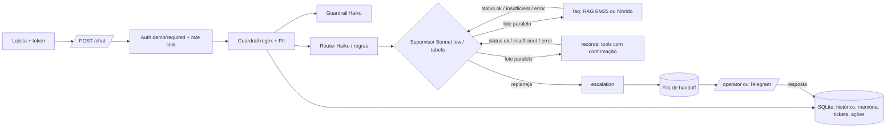

# Getnet Support Agents

Sistema multiagente que atende lojistas da Getnet num único `POST /chat` (pt ou en): o Router classifica a mensagem, o Knowledge Agent responde com RAG sobre o site oficial da Getnet (ou busca web para assunto geral), o Customer Support Agent consulta os dados do próprio lojista por ferramentas com confirmação, e o Human Escalation Agent leva ao operador o que não tem fonte ou confiança. Métrica de negócio: resolução automática sem número inventado.

| | |
|---|---|
| Rodar | `docker compose up -d --build` → `http://localhost:8000/docs` · console do operador em `/operator` |
| Testar | `python scripts/check.py --docker --scale` (lint, testes, eval com gate, build, imagem sem extras, smoke do container, 2 réplicas atrás de balanceador) |
| CI | [`.github/workflows/ci.yml`](.github/workflows/ci.yml): lint, testes, eval offline com gate, build, smoke do container e 2 réplicas; o último run verde fica na aba Actions do repositório |
| Vídeo | [docs/video/walkthrough.mp4](docs/video/walkthrough.mp4) (legendado, sem narração; respostas reais do `POST /chat` com LLM e números lidos de `evals/results/`; roteiro em [docs/VIDEO_SCRIPT.md](docs/VIDEO_SCRIPT.md)) |

## 0. Para quem avalia em 5 minutos

| Minuto | O quê | Comando / onde |
|---|---|---|
| 1 | subir e perguntar (payload literal do enunciado) | `docker compose up -d --build` e o `curl` da §1 |
| 2 | conferir que tudo passa, do lint ao container | `python scripts/check.py --docker` (CI: link no topo) |
| 3 | números, todos gerados do `evals/results/` commitado | §5 (offline com gate, ao vivo com pass^3, juiz calibrado, replanejamento com × sem, matriz de confusão) |
| 4 | onde cada critério da régua está provado, e o limite de cada um | §3 (o `check.py` reprova prova citada que falha) |
| 5 | o que é kit e o que foi feito no relógio | §8 e `git log` |

## 1. Como rodar

```bash
cp .env.example .env                      # opcional: sem chave roda no modo offline determinístico
docker compose up -d --build                # o compose já liga AUTH_MODE=demo (payload literal)
curl -s localhost:8000/health

# 1) payload LITERAL do enunciado (AUTH_MODE=demo: user_id do corpo; a resposta marca identity_verified=false)
curl -s -X POST localhost:8000/chat -H "Content-Type: application/json" \
     -d '{"message":"When will the money from yesterday'"'"'s sales be deposited?","user_id":"cliente1988"}'

# 2) com identidade verificada (JWT assinado para o lojista cliente1988 do CRM fictício)
TOKEN=$(docker compose exec -T api python -m app.auth cliente1988)
curl -s -X POST localhost:8000/chat -H "Authorization: Bearer $TOKEN" \
     -H "Content-Type: application/json" -d '{"message":"Minha maquininha não conecta na internet, o que faço?"}'
```

**Testar tudo** (lint, testes, eval offline com gate, build, smoke do container, 2 réplicas atrás de
balanceador): `python scripts/check.py --docker --scale`. Sem Docker: `python scripts/check.py`.

- **Identidade:** `AUTH_MODE=required` (só Bearer) ou `demo` (aceita `user_id` do corpo, marca
  `identity_verified=false`, rate limit por IP). Decisão em [docs/adr/0001-auth-mode-demo.md](docs/adr/0001-auth-mode-demo.md).
- **Operador humano:** `/operator` (token digitado na página, nunca embutido), `GET /handoffs`,
  `POST /handoffs/{id}/reply` com `X-Operator-Token`. A resposta entra na conversa do cliente e o
  próximo turno já a enxerga. Opcional: Telegram (`TELEGRAM_*` no `.env`) avisa o caso e aceita
  `/responder T-xxxx texto` pelo webhook `/telegram/webhook`.
- **Ao vivo:** `scripts/live_eval.sh --max-usd 3` (ou `powershell -File scripts/live_eval.ps1 -MaxUsd 3`; eval por split com teto de US$,
  juiz e README). Extras opcionais fora da imagem: `.[hybrid]` (busca híbrida) e `.[otel]` (OpenTelemetry).

## 2. Arquitetura



**Por que essa divisão:** uma fonte de verdade por agente, e um contrato só entre eles (`AgentResult` com
`status` `ok`/`insufficient`/`error`, em `src/app/schemas.py`). Quem lê o status e replaneja é o supervisor;
nenhum agente chama outro. Três diagramas (turno, RAG, HITL) em [docs/ARCHITECTURE.md](docs/ARCHITECTURE.md);
operação em [docs/OBSERVABILITY.md](docs/OBSERVABILITY.md) e [docs/RUNBOOK.md](docs/RUNBOOK.md).

### Agente do enunciado → nome no código → fonte de verdade

| Agente do enunciado | Nome no código | Fonte de verdade | Arquivo |
|---|---|---|---|
| Router Agent (entrada; "manages the workflow and data flow") | `router` + `supervisor` | taxonomia e planos do domínio (`PLANS`, `FALLBACK`, `ALLOWED`, `DEPENDS`, `NO_ESCALATION`) | `src/app/router.py`, `src/app/supervisor.py`, `src/app/domain/challenge/flow.py` |
| Knowledge Agent | `faq` | site da Getnet indexado (RAG); busca web só para `general` | `src/app/agents.py`, `src/app/rag.py`, `src/app/ingest.py` |
| Customer Support Agent | `records` | CRM fictício do lojista, só por ferramentas, com identidade do servidor | `src/app/agents.py`, `src/app/domain/challenge/tools.py`, `src/app/actions.py` |
| Human Escalation Agent (bônus) | `escalation` | fila de handoff persistida no SQLite + operador | `src/app/agents.py`, `src/app/store.py`, `src/app/resume.py` |

`faq`/`records` são o contrato do kit (`schemas.AgentName`); a documentação e as respostas usam os nomes do enunciado.

### Taxonomia de intenções ([docs/SPEC.md](docs/SPEC.md); o Router devolve exatamente uma)

| Intent | Quando | Plano inicial | Se falhar |
|---|---|---|---|
| `knowledge` | como funciona produto, serviço, tarifa ou regra da Getnet, sem dado do lojista | Knowledge | sem fonte → humano |
| `support` | dado do próprio lojista: vendas, recebimentos, saldo, antecipação dele, contestação dele | Customer Support | erro de tool → Knowledge → humano |
| `troubleshoot` | sintoma na maquininha ou numa transação (não conecta, erro, recusa, travou) | Customer Support → Knowledge | humano |
| `general` | fora da Getnet e respondível pela web (clima, câmbio, notícia) | Knowledge com busca web | nunca escala: sem web, diz que não sabe |
| `multi` | duas perguntas de intenções diferentes | união ordenada, em paralelo quando independentes | conforme cada parte |
| `human_request` | pede atendente | Human Escalation | — |
| `blocked` | guardrail barrou (injeção, jailbreak, dado de terceiro, abuso) | — | recusa padrão |

**Desempates (da SPEC):** sintoma ("não conecta", "erro", "recusada", "travou") → `troubleshoot`, mesmo com
"minha maquininha"; pedido de dado ("quando cai", "quanto vendi", "meu saldo", "antecipar o meu valor") →
`support`; "preciso de / como funciona / posso" sobre produto, sem pedir dado do lojista → `knowledge` (AC-04,
"Do I need a bank account to receive my sales via Pix?"); produto que a Getnet não tem ou outro banco →
`knowledge` (o RAG não acha → humano), não `general`.

### Fluxo de uma mensagem

| Etapa | Arquivo | Usa LLM? |
|---|---|---|
| Autenticação (`AUTH_MODE` required/demo) e rate limit | `src/app/api.py`, `src/app/auth.py` | não |
| Guardrail de entrada: regex, desofuscação, máscara de PII | `src/app/guardrails.py` | não |
| Guardrail semântico (injeção, jailbreak, abuso) | `src/app/guardrails.py` | sim (Haiku); sem LLM fica o regex |
| Router: intenção, idioma, confiança, plano | `src/app/router.py`, `src/app/domain/challenge/flow.py` | sim (Haiku com JSON schema e few-shot); offline: regras + k-NN |
| Supervisor: executa o plano, lê o status, replaneja | `src/app/supervisor.py` | sim (agentes como tools); fallback na tabela determinística |
| Knowledge: busca, rerank, redação com citação `[n]` | `src/app/agents.py`, `src/app/rag.py` | busca não; rerank e redação sim |
| Customer Support: ferramentas sobre o CRM | `src/app/agents.py`, `src/app/domain/challenge/tools.py` | escolha e redação sim; execução e identidade não |
| Ação de escrita: confirmação do dono, quatro olhos se `high` | `src/app/actions.py` | não |
| Checagem numérica e flags de risco | `src/app/grounding.py` | não (todo turno) |
| Human Escalation, fila, retomada | `src/app/agents.py`, `src/app/store.py`, `src/app/resume.py` | só a redação da retomada |
| Log JSON, métricas, custo, trace | `src/app/observability.py`, `src/app/analytics.py` | não |

### RAG: ingestão → armazenamento → busca → geração

1. **Ingestão** (`python -m app.ingest`, `src/app/ingest.py`): lê `data/sources.json` com duas fontes,
   `www.getnet.net/en` (a indicada no enunciado) e `site.getnet.com.br` (onde estão Get Clássica, Get Smart,
   crediário e Link de Pagamento); baixa só hosts de `allowed_hosts`, tira menu, rodapé e script, e corta em
   trechos com título, URL e data de coleta.
2. **Armazenamento:** trechos em JSONL no diretório de dados, versionados no git; documento com instrução
   embutida é descartado na carga (`poisoned_docs_dropped_total`).
3. **Busca** (`src/app/rag.py`): BM25 com título em peso 2 e glossário pt↔en (`data/glossary.json`, ex.:
   "antecipação" ↔ "advance"); `RETRIEVER=hybrid` soma embeddings por RRF (extra `.[hybrid]`); com LLM o Haiku
   reordena o top-20 (`RERANK`) e, se falhar, fica a ordem do BM25 (`rerank_fallback_total`).
4. **Geração** (`src/app/agents.py`): o Knowledge Agent redige só com os trechos, citando `[n]`; abaixo do limiar
   de cobertura (`COVERAGE_MIN_SCORE`, escolhido por medida no eval) devolve `insufficient` e o supervisor
   escala. **Sem fonte, sem afirmação.**

### Como usamos LLM, e onde não

Usamos: guardrail semântico, Router, supervisor, rerank, redação do Knowledge e do Customer Support, retomada
após o operador e juiz do eval (fora do caminho da resposta). **Não usamos** (determinístico, testável, sem
custo): identidade (vem do token), autorização e execução de ferramentas, confirmação e quatro olhos, checagem
de número contra fonte, máscara de PII, rate limit, fallback do supervisor, métricas e custo. Sem chave
(`LLM_PROVIDER=offline`) tudo roda pelo caminho determinístico, que é o que o CI mede.

## 3. Cobertura da régua de avaliação

Mapa para quem avalia **lendo**: código, teste que prova e onde está o número. Os números vêm dos
blocos da §5, gerados de `evals/results/` por `scripts/fill_readme.py`. Todo caminho em crase desta
seção existe: `tests/test_evidence.py` falha se um sumir. Reproduzir tudo: `python scripts/check.py --docker`.

| Critério | O que foi feito | Código | Prova | Número | Limite conhecido |
|---|---|---|---|---|---|
| Business & Challenge Fit | Os 10 cenários literais do enunciado (AC-01…AC-10: Get Clássica × Get Smart, clima, depósito de ontem, Pix, maquininha sem internet, antecipação, câmbio, recusa, crediário, Link de Pagamento) viram o split `official` de `evals/cases.jsonl` com intent, tool e handoff esperados; KPI: resolução automática sem número inventado | `src/app/domain/challenge/flow.py`, `src/app/tools.py` | `evals/cases.jsonl`, `docs/SPEC.md` | §5 Offline e Ao vivo, `official` | Mede os 10 cenários e variações; CRM fictício (2 lojistas), sem integração com sistemas Getnet reais |
| Orchestration | Supervisor LLM com agentes como tools, lê `insufficient`/`error` e replaneja; tabela PLANS/FALLBACK/ALLOWED/MAX_STEPS; agentes independentes em paralelo | `src/app/supervisor.py` | `tests/test_supervisor.py::test_llm_reads_insufficient_and_replans_to_escalation`, `tests/test_supervisor.py::test_llm_disallowed_transition_is_refused`, `tests/test_parallel.py::test_independent_agents_run_in_parallel_in_plan_order` | §5 Replanejamento, splits `replan` e `parallel` | Replaneja só dentro de `ALLOWED` e `MAX_STEPS` (4 chamadas por turno); o ganho do LLM sobre a tabela é medido em casos escritos pelo autor |
| Router | Haiku com JSON schema e few-shot dinâmico (8 exemplos mais parecidos); regra por frase + k-NN de n-gramas no offline; seguimento pela última fala com assunto; teste que reprova frase do held-out copiada para regra | `src/app/router.py` | `tests/test_router.py::test_llm_failure_falls_back_to_rules`, `tests/test_router_knn.py::test_unseen_paraphrase_goes_to_right_intent`, `tests/test_router_followup.py::test_follow_up_skips_acknowledgement`, `tests/test_router_contamination.py::test_detector_catches_v3_leak` | §5 Offline, `intent_acc` | Uma intenção por cláusula; a confiança do Router não é calibrada; o held-out cego mede generalização, mas fica fora do gate |
| Context, Knowledge & RAG | BM25 e híbrido (RRF) atrás de `RETRIEVER`, com **rerank do top-20 pelo Haiku** quando há LLM; "sem fonte, sem afirmação"; **todo número da resposta conferido contra fonte, tool e pergunta** (sem LLM; `unsupported_numbers` na resposta) | `src/app/rag.py`, `src/app/grounding.py` | `tests/test_rag.py::test_compare_retrievers_reports_both`, `tests/test_rerank.py::test_rerank_follows_the_llm_order_and_keeps_bm25_scores`, `tests/test_rerank_eval.py::test_compare_adds_a_rerank_row_only_when_asked`, `tests/test_agents.py::test_faq_llm_not_in_sources_is_insufficient`, `tests/test_grounding.py::test_pipeline_flags_invented_number_and_counts_it`, `evals/retrieval.jsonl` | §5 Offline, Recall@3, MRR e `numbers_acc` | Corpus é um recorte das duas fontes, sem coleta agendada; páginas atrás de login e PDFs ficam de fora; limiar calibrado num conjunto pequeno |
| Tool & Action | JSON Schema, identidade do servidor, escrita com confirmação do dono; **risco alto com aprovação de operador (quatro olhos)**; ação pendente expira (TTL); execução única entre réplicas; **servidor MCP em `/mcp`** (ask, search_knowledge, crm_tool; JWT obrigatório) | `src/app/actions.py`, `src/app/tools.py`, `src/app/mcp_server.py` | `tests/test_mcp.py::test_crm_tool_identity_comes_from_token_and_write_needs_confirmation`, `tests/test_mcp.py::test_anonymous_gets_401_before_the_protocol`, `tests/test_agents.py::test_tool_identity_is_server_side`, `tests/test_hitl.py::test_high_risk_action_needs_owner_then_operator_and_runs_once`, `tests/test_hitl.py::test_pending_action_expires`, `tests/test_memory_and_handoff.py::test_claim_is_atomic` | §5 Offline, `tools_acc` | Ferramentas sobre CRM fictício; a ação de risco não tem limite de valor configurável, todo `high` vai ao operador |
| Security & Identity | JWT HS256 com `exp`/`iss`/`aud`/`jti` e revogação; operador com chave pessoal (auditoria); rate limit no SQLite que falha fechado; `AUTH_MODE` required/demo; guardrails regex + Haiku com desofuscação e injeção indireta; PII mascarada na entrada, no log e na saída | `src/app/auth.py`, `src/app/guardrails.py` | `tests/test_identity.py::test_expired_token_is_rejected`, `tests/test_identity.py::test_revoked_token_is_rejected_via_api`, `tests/test_identity.py::test_rate_limit_fails_closed`, `tests/test_guardrails.py::test_obfuscated_injection_is_caught`, `tests/test_guardrails.py::test_poisoned_document_is_dropped_at_load`, `docs/adr/0001-auth-mode-demo.md` | §5 Offline, split `guardrail` | Segredo HS256 único, sem rotação de chave (JWKS); em `AUTH_MODE=demo` o `user_id` do corpo é aceito e marcado `identity_verified=false` |
| Memory, State & Resilience | Histórico em SQLite (WAL, vários processos) com **resumo rolante** além da janela; memória de longo prazo por usuário; queda do LLM cai no determinístico | `src/app/store.py`, `src/app/pipeline.py` | `tests/test_memory_and_handoff.py::test_history_survives_restart`, `tests/test_analytics.py::test_rolling_digest_keeps_early_facts_beyond_the_window`, `tests/test_identity.py::test_sqlite_survives_concurrent_writers`, `tests/test_agents.py::test_records_llm_failure_uses_deterministic_path`, `tests/test_runtime_store.py::test_two_replicas_escalating_the_same_conversation_open_one_ticket`, `scripts/scale_smoke.py` (conversa continua entre 2 réplicas, réplica cai e o atendimento segue) | §5 Offline, split `memory` | Réplicas só no mesmo host (SQLite em volume compartilhado, ADR 0002); memória de longo prazo não expira |
| Human Oversight | Fila persistida e console; **a resposta do operador retoma a conversa na hora**; aprovação de ação de risco; SLA com re-escalonamento único; Telegram ida e volta | `src/app/resume.py`, `src/app/api.py`, `src/app/notify.py` | `tests/test_hitl.py::test_operator_reply_resumes_the_conversation_immediately`, `tests/test_hitl.py::test_overdue_case_is_escalated_once`, `tests/test_hitl.py::test_two_simultaneous_replies_only_one_wins`, `tests/test_notify.py::test_reply_from_telegram_resumes_conversation` | §5 Offline, `handoff_acc` | Um operador por caso, sem roteamento por especialidade; Telegram opcional e sem reenvio em falha |
| Evaluation & Quality | Gate offline no CI; ao vivo por split com teto de US$; `--repeat N` (pass^k, instáveis); juiz calibrado (kappa, TPR/TNR); checagem numérica sem LLM; matriz de falhas; limiar do portão por medida | `evals/run_evals.py`, `evals/judge.py`, `src/app/grounding.py` | `tests/test_evals.py::test_gate_passes_in_process`, `tests/test_evals.py::test_calibration_reports_tpr_tnr`, `tests/test_evals.py::test_repeat_reports_pass_hat_k_and_unstable_cases`, `tests/test_rag.py::test_gate_threshold_is_chosen_by_measurement`, `tests/test_eval_isolation.py::test_each_case_starts_without_memory_of_other_cases`, `tests/test_eval_judge_evidence.py::test_live_rows_record_tool_calls_sources_and_evidence`, `tests/test_eval_language_ci.py::test_detects_language_of_the_text`, `evals/judge_calibration.jsonl` | §5 Offline, Ao vivo e Juiz | Juiz calibrado com um rotulador só (o autor); ao vivo com amostra pequena por custo |
| Observability, Reliability & Cost | Log JSON com `trace_id` e status de cada agente; US$ e tokens por request; `/metrics`; **alertas Prometheus provisionados**; `/analytics` (resolução, custo por resolvido, 👍/👎); OTel por env | `src/app/observability.py`, `src/app/analytics.py`, `ops/alerts.yml` | `tests/test_agents.py::test_cost_per_request_from_price_table`, `tests/test_alerts.py::test_alert_rules_are_valid_and_actionable`, `tests/test_analytics.py::test_every_request_is_logged_and_feedback_is_owned`, `tests/test_otel.py::test_console_exporter_emits_span_linked_to_trace_id` | §5 Ao vivo, `cost_usd` e p95 | Métricas em memória por processo (cada réplica expõe as suas); sem dashboard provisionado |
| Production Engineering | Dockerfile multi-stage não-root, base fixada por digest com Dependabot, extra opcional embutido (`EXTRAS=hybrid`), lockfiles, smoke do container e **2 réplicas atrás de balanceador** no CI; scripts em bash e PowerShell | `Dockerfile` | `scripts/check.py`, `.github/workflows/ci.yml`, `.github/dependabot.yml`, `requirements.lock`, `requirements-hybrid.lock`, `scripts/live_eval.sh` | link do CI no topo | Sem deploy em nuvem gerenciada; réplicas e balanceador testados num host com Docker |
| Engineering Judgment | Decisões com a alternativa descartada (ADRs 0001–0007); limitações declaradas; kit declarado no 1º commit (ADR 0003) | `docs/adr/0001-auth-mode-demo.md`, `docs/adr/0002-replicas-mesmo-host.md` | §4 e §9 deste README | — | ADRs escritas sob relógio; modelo por papel não foi comparado em custo × qualidade |

## 4. Decisões e trade-offs

| Decisão | Alternativa descartada | Motivo |
|---|---|---|
| Supervisor LLM com tabela determinística como fallback | só LLM / só tabela | replan inteligente ao vivo; CI e falha do provedor seguem determinísticos |
| Agentes independentes em threads | asyncio | os agentes fazem I/O síncrono (SQLite, SDK); threads cortam o p95 sem reescrever a pilha |
| Effort por papel (supervisor low, agentes medium) | um effort global | o supervisor só escolhe o próximo passo; quem redige com fonte precisa de mais |
| BM25 padrão, híbrido atrás de flag | embeddings desde o início | dependência pesada só entra se Recall@3/MRR mostrarem ganho |
| SQLite atrás de `Store` | Postgres/Redis | sobe com um comando; a troca para réplicas fica isolada num módulo |
| Kit declarado no 1º commit, domínio escrito no relógio ([ADR 0003](docs/adr/0003-kit-declarado-dominio-no-relogio.md)) | escrever tudo do zero no prazo | o tempo vai para a Getnet (taxonomia, RAG, ferramentas, casos); o `git log` separa o que é kit do que é desafio |
| Supervisor LLM com agentes como tools e tabela de fallback ([ADR 0004](docs/adr/0004-supervisor-llm-tabela-fallback.md)) | grafo fixo / só LLM | replaneja ao vivo pelo status; sem chave ou com o provedor fora, a tabela responde igual; ablação com × sem (`SUPERVISOR_REPLAN`) |
| Duas fontes no RAG, BM25 + glossário pt↔en + rerank ([ADR 0005](docs/adr/0005-rag-duas-fontes-bm25-glossario.md)) | só a URL do enunciado; embeddings sempre | Get Clássica, crediário e Link de Pagamento só estão no site brasileiro; híbrido fica atrás de flag até medir ganho |
| Checagem numérica e flags de risco sem LLM em todo turno ([ADR 0006](docs/adr/0006-checagem-numerica-sem-llm.md)) | juiz LLM no caminho da resposta | custo e latência por turno; regex de número é determinística e testável |
| Retomada imediata após o operador; quatro olhos em ação `high` ([ADR 0007](docs/adr/0007-hitl-retomada-quatro-olhos.md)) | operador só fecha o ticket | o lojista vê a resposta no próximo turno; antecipação e contestação mexem em dinheiro |
| Router devolve uma intenção por cláusula, com desempates escritos na SPEC | multi-rótulo livre | AC-04 ("bank account… Pix") foi errado na v3; regra escrita e testada evita oscilação |
| `AUTH_MODE=demo` só por variável no compose ([ADR 0001](docs/adr/0001-auth-mode-demo.md)) | só Bearer | o enunciado manda `{"message","user_id"}`; `required` é o padrão e continua testado |

## 5. Avaliação

Números gerados por `python scripts/fill_readme.py` a partir de `evals/results/`.

### Offline (gate do CI)

<!-- eval:begin -->
Modo: `in-process` · provedor `offline`

| Métrica | official | replan | parallel | approval | official-var | memory | guardrail | hard | heldout | ALL |
|---|---:|---:|---:|---:|---:|---:|---:|---:|---:|---:|
| cases | 10 | 20 | 8 | 8 | 32 | 13 | 38 | 21 | 24 | 174 |
| intent_acc | 100.0 [IC95 72.2–100.0; n=10] | 100.0 [IC95 83.9–100.0; n=20] | 100.0 [IC95 67.6–100.0; n=8] | 100.0 [IC95 67.6–100.0; n=8] | 93.8 [IC95 79.9–98.3; n=32] | 84.6 [IC95 57.8–95.7; n=13] | 97.4 [IC95 86.5–99.5; n=38] | 71.4 [IC95 50.0–86.2; n=21] | 75.0 [IC95 55.1–88.0; n=24] | 90.2 [IC95 84.9–93.8; n=174] |
| handoff_acc | 100.0 [IC95 72.2–100.0; n=10] | 60.0 [IC95 38.7–78.1; n=20] | 100.0 [IC95 67.6–100.0; n=8] | 100.0 [IC95 67.6–100.0; n=8] | 93.8 [IC95 79.9–98.3; n=32] | 92.3 [IC95 66.7–98.6; n=13] | 100.0 [IC95 89.3–100.0; n=32] | 94.4 [IC95 74.2–99.0; n=18] | 81.8 [IC95 61.5–92.7; n=22] | 90.2 [IC95 84.7–93.9; n=163] |
| handoff_outcome_acc | 100.0 [IC95 72.2–100.0; n=10] | 60.0 [IC95 38.7–78.1; n=20] | 100.0 [IC95 67.6–100.0; n=8] | 100.0 [IC95 67.6–100.0; n=8] | 93.8 [IC95 79.9–98.3; n=32] | 92.3 [IC95 66.7–98.6; n=13] | 100.0 [IC95 89.3–100.0; n=32] | 94.4 [IC95 74.2–99.0; n=18] | 81.8 [IC95 61.5–92.7; n=22] | 90.2 [IC95 84.7–93.9; n=163] |
| blocked_acc | — | — | — | — | — | — | 100.0 [IC95 90.8–100.0; n=38] | 0.0 [IC95 0.0–79.3; n=1] | 50.0 [IC95 9.5–90.5; n=2] | 95.1 [IC95 83.9–98.7; n=41] |
| language_acc | 50.0 [IC95 23.7–76.3; n=10] | 100.0 [IC95 83.9–100.0; n=20] | 100.0 [IC95 67.6–100.0; n=8] | 100.0 [IC95 67.6–100.0; n=8] | 78.1 [IC95 61.2–89.0; n=32] | 92.3 [IC95 66.7–98.6; n=13] | 83.3 [IC95 43.6–97.0; n=6] | 90.5 [IC95 71.1–97.3; n=21] | 90.9 [IC95 72.2–97.5; n=22] | 87.1 [IC95 80.6–91.7; n=140] |
| tools_acc | 100.0 [IC95 43.9–100.0; n=3] | — | 100.0 [IC95 67.6–100.0; n=8] | 100.0 [IC95 67.6–100.0; n=8] | 88.9 [IC95 56.5–98.0; n=9] | 66.7 [IC95 30.0–90.3; n=6] | — | 75.0 [IC95 40.9–92.9; n=8] | 83.3 [IC95 55.2–95.3; n=12] | 87.0 [IC95 75.6–93.6; n=54] |
| pending_action_acc | — | — | — | 100.0 [IC95 67.6–100.0; n=8] | — | — | — | — | 100.0 [IC95 43.9–100.0; n=3] | 100.0 [IC95 74.1–100.0; n=11] |
| replanned_acc | — | 60.0 [IC95 38.7–78.1; n=20] | — | — | — | — | — | — | — | 60.0 [IC95 38.7–78.1; n=20] |
| no_leak_acc | — | — | — | — | — | — | 100.0 [IC95 34.2–100.0; n=2] | — | — | 100.0 [IC95 34.2–100.0; n=2] |
| numbers_acc | 100.0 [IC95 72.2–100.0; n=10] | 100.0 [IC95 83.9–100.0; n=20] | 100.0 [IC95 67.6–100.0; n=8] | 100.0 [IC95 67.6–100.0; n=8] | 100.0 [IC95 89.3–100.0; n=32] | 100.0 [IC95 77.2–100.0; n=13] | 100.0 [IC95 61.0–100.0; n=6] | 100.0 [IC95 83.9–100.0; n=20] | 100.0 [IC95 85.7–100.0; n=23] | 100.0 [IC95 97.3–100.0; n=140] |
| language_undetected | 0 | 0 | 0 | 0 | 0 | 0 | 0 | 0 | 0 | 0 |
| recall@3 | — | — | — | — | — | — | — | — | — | — |
| mrr | — | — | — | — | — | — | — | — | — | — |
| p50_ms | 22.6 | 25.3 | 30.4 | 17.4 | 17.1 | 38.5 | 4.6 | 19.8 | 28.0 | 19.8 |
| p95_ms | 292.6 | 51.6 | 56.8 | 23.4 | 23.9 | 51.2 | 21.7 | 29.2 | 35.7 | 42.7 |
| cost_usd | 0.0 | 0.0 | 0.0 | 0.0 | 0.0 | 0.0 | 0.0 | 0.0 | 0.0 | 0.0 |
| crashes | 0 | 0 | 0 | 0 | 0 | 0 | 0 | 0 | 0 | 0 |

Gate (splits approval, guardrail, memory, official, official-var, parallel, replan): intent 96.1% [IC95 91.2–98.3; n=129] (mínimo 90%) → **PASS**. Medidos fora do gate: hard, heldout. Isolamento: `db_per_case`.

Falhas por checagem × split: blocked hard 1, heldout 1 · handoff hard 1, heldout 4, memory 1, official-var 2, replan 8 · handoff_outcome hard 1, heldout 4, memory 1, official-var 2, replan 8 · intent guardrail 1, hard 6, heldout 6, memory 2, official-var 2 · language guardrail 1, hard 2, heldout 2, memory 1, official 5, official-var 7 · replanned replan 8 · tools hard 2, heldout 2, memory 2, official-var 1
Confusão de intenção (esperada → obtida): blocked → support 1 · general → knowledge 2 · knowledge → support 1, blocked 1, troubleshoot 1 · multi → troubleshoot 2, support 1, knowledge 1 · support → knowledge 2, multi 1 · troubleshoot → knowledge 3, support 1

Matriz de confusão do router (todos os splits):

| esperada \ obtida | blocked | general | human_request | knowledge | multi | support | troubleshoot | acerto |
|---|---:|---:|---:|---:|---:|---:|---:|---:|
| blocked | **33** | · | · | · | · | 1 | · | 97% |
| general | · | **17** | · | 2 | · | · | · | 89% |
| human_request | · | · | **4** | · | · | · | · | 100% |
| knowledge | 1 | · | · | **57** | · | 1 | 1 | 95% |
| multi | · | · | · | 1 | **9** | 1 | 2 | 69% |
| support | · | · | · | 2 | 1 | **20** | · | 87% |
| troubleshoot | · | · | · | 3 | · | 1 | **17** | 81% |

Portão sem fonte: limiar efetivo 8.554 (MIN_SCORE) → responde 72.0% [IC95 58.3–82.5; n=50] dos com fonte, recusa 81.2% [IC95 57.0–93.4; n=16] dos sem fonte · recomendado 8.643 → responde 72.0% [IC95 58.3–82.5; n=50], recusa 87.5% [IC95 64.0–96.5; n=16] (50 com fonte, 16 sem; 0 sem fonte fora da conta por não chegarem ao agente de conhecimento; critério: max pos_answered com neg_refused >= 0.85; empate → menor limiar)

Retrieval ativo (bm25, `evals/retrieval.jsonl`): Recall@3 **0.486** · MRR **0.61** · hit@3 0.72 [IC95 58.3–82.5; n=50] (50 perguntas)
<!-- eval:end -->

### Ao vivo (LLM real, por split)

<!-- eval-live:begin -->
### Split `approval` — `live_approval.json`

Provedor `anthropic` · status `aborted_max_usd` · gasto US$ 0.026346 (teto 0.0202)

| Métrica | approval | ALL |
|---|---:|---:|
| cases | 1 | 1 |
| intent_acc | 100.0 [IC95 20.7–100.0; n=1] | 100.0 [IC95 20.7–100.0; n=1] |
| handoff_acc | 100.0 [IC95 20.7–100.0; n=1] | 100.0 [IC95 20.7–100.0; n=1] |
| handoff_outcome_acc | 100.0 [IC95 20.7–100.0; n=1] | 100.0 [IC95 20.7–100.0; n=1] |
| blocked_acc | — | — |
| language_acc | 100.0 [IC95 20.7–100.0; n=1] | 100.0 [IC95 20.7–100.0; n=1] |
| tools_acc | 100.0 [IC95 20.7–100.0; n=1] | 100.0 [IC95 20.7–100.0; n=1] |
| pending_action_acc | 100.0 [IC95 20.7–100.0; n=1] | 100.0 [IC95 20.7–100.0; n=1] |
| replanned_acc | — | — |
| no_leak_acc | — | — |
| numbers_acc | 100.0 [IC95 20.7–100.0; n=1] | 100.0 [IC95 20.7–100.0; n=1] |
| language_undetected | 0 | 0 |
| recall@3 | — | — |
| mrr | — | — |
| p50_ms | 7784.9 | 7784.9 |
| p95_ms | 7784.9 | 7784.9 |
| cost_usd | 0.026346 | 0.026346 |
| crashes | 0 | 0 |

Gate (splits approval): intent 100.0% [IC95 20.7–100.0; n=1] (mínimo 90%) → **PASS**. Medidos fora do gate: hard, heldout. Isolamento: `db_per_case`.

Matriz de confusão do router (todos os splits):

| esperada \ obtida | support | acerto |
|---|---:|---:|
| support | **1** | 100% |

Portão sem fonte: limiar efetivo 8.554 (MIN_SCORE) → responde 72.0% [IC95 58.3–82.5; n=50] dos com fonte, recusa 81.2% [IC95 57.0–93.4; n=16] dos sem fonte · recomendado 8.643 → responde 72.0% [IC95 58.3–82.5; n=50], recusa 87.5% [IC95 64.0–96.5; n=16] (50 com fonte, 16 sem; 0 sem fonte fora da conta por não chegarem ao agente de conhecimento; critério: max pos_answered com neg_refused >= 0.85; empate → menor limiar)

Estabilidade (3 rodadas): pass@1 100.0% [IC95 20.7–100.0; n=1] · pass^3 100.0% [IC95 20.7–100.0; n=1] · instáveis: —

Ao vivo: status `aborted_max_usd` · gasto US$ 0.026346 (teto 0.0202) · erros de LLM 0

Retrieval ativo (bm25, `evals/retrieval.jsonl`): Recall@3 **0.486** · MRR **0.61** · hit@3 0.72 [IC95 58.3–82.5; n=50] (50 perguntas)

### Split `memory` — `live_memory.json`

Provedor `anthropic` · status `aborted_max_usd` · gasto US$ 0.501261 (teto 0.5215)

| Métrica | memory | ALL |
|---|---:|---:|
| cases | 12 | 12 |
| intent_acc | 83.3 [IC95 55.2–95.3; n=12] | 83.3 [IC95 55.2–95.3; n=12] |
| handoff_acc | 91.7 [IC95 64.6–98.5; n=12] | 91.7 [IC95 64.6–98.5; n=12] |
| handoff_outcome_acc | 91.7 [IC95 64.6–98.5; n=12] | 91.7 [IC95 64.6–98.5; n=12] |
| blocked_acc | — | — |
| language_acc | 91.7 [IC95 64.6–98.5; n=12] | 91.7 [IC95 64.6–98.5; n=12] |
| tools_acc | 100.0 [IC95 61.0–100.0; n=6] | 100.0 [IC95 61.0–100.0; n=6] |
| pending_action_acc | — | — |
| replanned_acc | — | — |
| no_leak_acc | — | — |
| numbers_acc | 58.3 [IC95 32.0–80.7; n=12] | 58.3 [IC95 32.0–80.7; n=12] |
| language_undetected | 0 | 0 |
| recall@3 | — | — |
| mrr | — | — |
| p50_ms | 26920.9 | 26920.9 |
| p95_ms | 31162.9 | 31162.9 |
| cost_usd | 0.501261 | 0.501261 |
| crashes | 0 | 0 |

Gate (splits memory): intent 83.3% [IC95 55.2–95.3; n=12] (mínimo 90%) → **FAIL**. Medidos fora do gate: hard, heldout. Isolamento: `db_per_case`.

Falhas por checagem × split: handoff memory 1 · handoff_outcome memory 1 · intent memory 2 · language memory 1 · numbers memory 5
Confusão de intenção (esperada → obtida): troubleshoot → support 2

Matriz de confusão do router (todos os splits):

| esperada \ obtida | general | knowledge | support | troubleshoot | acerto |
|---|---:|---:|---:|---:|---:|
| general | **4** | · | · | · | 100% |
| knowledge | · | **2** | · | · | 100% |
| support | · | · | **2** | · | 100% |
| troubleshoot | · | · | 2 | **2** | 50% |

Portão sem fonte: limiar efetivo 8.554 (MIN_SCORE) → responde 72.0% [IC95 58.3–82.5; n=50] dos com fonte, recusa 81.2% [IC95 57.0–93.4; n=16] dos sem fonte · recomendado 8.643 → responde 72.0% [IC95 58.3–82.5; n=50], recusa 87.5% [IC95 64.0–96.5; n=16] (50 com fonte, 16 sem; 0 sem fonte fora da conta por não chegarem ao agente de conhecimento; critério: max pos_answered com neg_refused >= 0.85; empate → menor limiar)

Estabilidade (3 rodadas): pass@1 33.3% [IC95 13.8–60.9; n=12] · pass^3 33.3% [IC95 13.8–60.9; n=12] · instáveis: —

Ao vivo: status `aborted_max_usd` · gasto US$ 0.501261 (teto 0.5215) · erros de LLM 0

Retrieval ativo (bm25, `evals/retrieval.jsonl`): Recall@3 **0.486** · MRR **0.61** · hit@3 0.72 [IC95 58.3–82.5; n=50] (50 perguntas)

### Split `official` — `live_official.json`

Provedor `anthropic` · status `complete` · gasto US$ 0.869273 (teto 3.0)

| Métrica | official | ALL |
|---|---:|---:|
| cases | 30 | 30 |
| intent_acc | 100.0 [IC95 88.6–100.0; n=30] | 100.0 [IC95 88.6–100.0; n=30] |
| handoff_acc | 96.7 [IC95 83.3–99.4; n=30] | 96.7 [IC95 83.3–99.4; n=30] |
| handoff_outcome_acc | 96.7 [IC95 83.3–99.4; n=30] | 96.7 [IC95 83.3–99.4; n=30] |
| blocked_acc | — | — |
| language_acc | 93.3 [IC95 78.7–98.2; n=30] | 93.3 [IC95 78.7–98.2; n=30] |
| tools_acc | 100.0 [IC95 70.1–100.0; n=9] | 100.0 [IC95 70.1–100.0; n=9] |
| pending_action_acc | — | — |
| replanned_acc | — | — |
| no_leak_acc | — | — |
| numbers_acc | 66.7 [IC95 48.8–80.8; n=30] | 66.7 [IC95 48.8–80.8; n=30] |
| language_undetected | 0 | 0 |
| recall@3 | — | — |
| mrr | — | — |
| p50_ms | 9398.6 | 9398.6 |
| p95_ms | 15445.5 | 15445.5 |
| cost_usd | 0.869273 | 0.869273 |
| crashes | 0 | 0 |

Gate (splits official): intent 100.0% [IC95 88.6–100.0; n=30] (mínimo 90%) → **PASS**. Medidos fora do gate: hard, heldout. Isolamento: `db_per_case`.

Falhas por checagem × split: handoff official 1 · handoff_outcome official 1 · language official 2 · numbers official 10

Matriz de confusão do router (todos os splits):

| esperada \ obtida | general | knowledge | support | troubleshoot | acerto |
|---|---:|---:|---:|---:|---:|
| general | **6** | · | · | · | 100% |
| knowledge | · | **15** | · | · | 100% |
| support | · | · | **3** | · | 100% |
| troubleshoot | · | · | · | **6** | 100% |

Portão sem fonte: limiar efetivo 8.554 (MIN_SCORE) → responde 72.0% [IC95 58.3–82.5; n=50] dos com fonte, recusa 81.2% [IC95 57.0–93.4; n=16] dos sem fonte · recomendado 8.643 → responde 72.0% [IC95 58.3–82.5; n=50], recusa 87.5% [IC95 64.0–96.5; n=16] (50 com fonte, 16 sem; 0 sem fonte fora da conta por não chegarem ao agente de conhecimento; critério: max pos_answered com neg_refused >= 0.85; empate → menor limiar)

Estabilidade (3 rodadas): pass@1 60.0% [IC95 42.3–75.4; n=30] · pass^3 30.0% [IC95 10.8–60.3; n=10] · instáveis: official-01, official-03, official-05, official-06, official-08

Ao vivo: status `complete` · gasto US$ 0.869273 (teto 3.0) · erros de LLM 0

Retrieval ativo (bm25, `evals/retrieval.jsonl`): Recall@3 **0.486** · MRR **0.61** · hit@3 0.72 [IC95 58.3–82.5; n=50] (50 perguntas)

### Split `parallel` — `live_parallel.json`

Provedor `anthropic` · status `complete` · gasto US$ 0.723621 (teto 1.2451)

| Métrica | parallel | ALL |
|---|---:|---:|
| cases | 24 | 24 |
| intent_acc | 100.0 [IC95 86.2–100.0; n=24] | 100.0 [IC95 86.2–100.0; n=24] |
| handoff_acc | 87.5 [IC95 69.0–95.7; n=24] | 87.5 [IC95 69.0–95.7; n=24] |
| handoff_outcome_acc | 87.5 [IC95 69.0–95.7; n=24] | 87.5 [IC95 69.0–95.7; n=24] |
| blocked_acc | — | — |
| language_acc | 95.8 [IC95 79.8–99.3; n=24] | 95.8 [IC95 79.8–99.3; n=24] |
| tools_acc | 100.0 [IC95 86.2–100.0; n=24] | 100.0 [IC95 86.2–100.0; n=24] |
| pending_action_acc | — | — |
| replanned_acc | — | — |
| no_leak_acc | — | — |
| numbers_acc | 95.8 [IC95 79.8–99.3; n=24] | 95.8 [IC95 79.8–99.3; n=24] |
| language_undetected | 0 | 0 |
| recall@3 | — | — |
| mrr | — | — |
| p50_ms | 9283.0 | 9283.0 |
| p95_ms | 10093.7 | 10093.7 |
| cost_usd | 0.723621 | 0.723621 |
| crashes | 0 | 0 |

Gate (splits parallel): intent 100.0% [IC95 86.2–100.0; n=24] (mínimo 90%) → **PASS**. Medidos fora do gate: hard, heldout. Isolamento: `db_per_case`.

Falhas por checagem × split: handoff parallel 3 · handoff_outcome parallel 3 · language parallel 1 · numbers parallel 1

Matriz de confusão do router (todos os splits):

| esperada \ obtida | multi | acerto |
|---|---:|---:|
| multi | **24** | 100% |

Portão sem fonte: limiar efetivo 8.554 (MIN_SCORE) → responde 72.0% [IC95 58.3–82.5; n=50] dos com fonte, recusa 81.2% [IC95 57.0–93.4; n=16] dos sem fonte · recomendado 8.643 → responde 72.0% [IC95 58.3–82.5; n=50], recusa 87.5% [IC95 64.0–96.5; n=16] (50 com fonte, 16 sem; 0 sem fonte fora da conta por não chegarem ao agente de conhecimento; critério: max pos_answered com neg_refused >= 0.85; empate → menor limiar)

Estabilidade (3 rodadas): pass@1 79.2% [IC95 59.5–90.8; n=24] · pass^3 62.5% [IC95 30.6–86.3; n=8] · instáveis: parallel-01, parallel-02

Ao vivo: status `complete` · gasto US$ 0.723621 (teto 1.2451) · erros de LLM 0

Retrieval ativo (bm25, `evals/retrieval.jsonl`): Recall@3 **0.486** · MRR **0.61** · hit@3 0.72 [IC95 58.3–82.5; n=50] (50 perguntas)

### Split `replan` — `live_replan.json`

Provedor `anthropic` · status `complete` · gasto US$ 0.885597 (teto 2.1307)

| Métrica | replan | ALL |
|---|---:|---:|
| cases | 60 | 60 |
| intent_acc | 100.0 [IC95 94.0–100.0; n=60] | 100.0 [IC95 94.0–100.0; n=60] |
| handoff_acc | 95.0 [IC95 86.3–98.3; n=60] | 95.0 [IC95 86.3–98.3; n=60] |
| handoff_outcome_acc | 95.0 [IC95 86.3–98.3; n=60] | 95.0 [IC95 86.3–98.3; n=60] |
| blocked_acc | — | — |
| language_acc | 100.0 [IC95 94.0–100.0; n=60] | 100.0 [IC95 94.0–100.0; n=60] |
| tools_acc | — | — |
| pending_action_acc | — | — |
| replanned_acc | 95.0 [IC95 86.3–98.3; n=60] | 95.0 [IC95 86.3–98.3; n=60] |
| no_leak_acc | — | — |
| numbers_acc | 100.0 [IC95 94.0–100.0; n=60] | 100.0 [IC95 94.0–100.0; n=60] |
| language_undetected | 0 | 0 |
| recall@3 | — | — |
| mrr | — | — |
| p50_ms | 6973.2 | 6973.2 |
| p95_ms | 9732.5 | 9732.5 |
| cost_usd | 0.885597 | 0.885597 |
| crashes | 0 | 0 |

Gate (splits replan): intent 100.0% [IC95 94.0–100.0; n=60] (mínimo 90%) → **PASS**. Medidos fora do gate: hard, heldout. Isolamento: `db_per_case`.

Falhas por checagem × split: handoff replan 3 · handoff_outcome replan 3 · replanned replan 3

Matriz de confusão do router (todos os splits):

| esperada \ obtida | knowledge | acerto |
|---|---:|---:|
| knowledge | **60** | 100% |

Portão sem fonte: limiar efetivo 8.554 (MIN_SCORE) → responde 72.0% [IC95 58.3–82.5; n=50] dos com fonte, recusa 81.2% [IC95 57.0–93.4; n=16] dos sem fonte · recomendado 8.643 → responde 72.0% [IC95 58.3–82.5; n=50], recusa 87.5% [IC95 64.0–96.5; n=16] (50 com fonte, 16 sem; 0 sem fonte fora da conta por não chegarem ao agente de conhecimento; critério: max pos_answered com neg_refused >= 0.85; empate → menor limiar)

Estabilidade (3 rodadas): pass@1 95.0% [IC95 86.3–98.3; n=60] · pass^3 90.0% [IC95 69.9–97.2; n=20] · instáveis: replan-05, replan-18

Ao vivo: status `complete` · gasto US$ 0.885597 (teto 2.1307) · erros de LLM 1

Retrieval ativo (bm25, `evals/retrieval.jsonl`): Recall@3 **0.486** · MRR **0.61** · hit@3 0.72 [IC95 58.3–82.5; n=50] (50 perguntas)
<!-- eval-live:end -->

### Juiz LLM sobre as respostas ao vivo

<!-- judge:begin -->
_Juiz não rodado._
<!-- judge:end -->

### Replanejamento

<!-- replan:begin -->
| fonte | casos | replanned_acc | handoff_acc | handoff_outcome_acc | intent_acc |
|---|---:|---:|---:|---:|---:|
| offline | 20 | 60.0 [IC95 38.7–78.1; n=20] | 60.0 [IC95 38.7–78.1; n=20] | 60.0 [IC95 38.7–78.1; n=20] | 100.0 [IC95 83.9–100.0; n=20] |
| ao vivo (live_replan.json) | 60 | 95.0 [IC95 86.3–98.3; n=60] | 95.0 [IC95 86.3–98.3; n=60] | 95.0 [IC95 86.3–98.3; n=60] | 100.0 [IC95 94.0–100.0; n=60] |
| offline SEM replanejamento | 20 | 0.0 [IC95 0.0–16.1; n=20] | 0.0 [IC95 0.0–16.1; n=20] | 0.0 [IC95 0.0–16.1; n=20] | 100.0 [IC95 83.9–100.0; n=20] |
| ao vivo SEM replanejamento | 20 | 0.0 [IC95 0.0–16.1; n=20] | 0.0 [IC95 0.0–16.1; n=20] | 0.0 [IC95 0.0–16.1; n=20] | 100.0 [IC95 83.9–100.0; n=20] |

- `replan-02` (offline): faq:no_source->escalation
- `replan-03` (offline): faq:no_source->escalation
- `replan-06` (offline): faq:no_source->escalation
- `replan-07` (offline): faq:no_source->escalation
- `replan-08` (offline): faq:no_source->escalation

Ablação (offline): desfecho certo no split replan **60.0% com** × **0.0% sem** replanejamento (mesmos 20 casos).
Ablação (ao vivo): desfecho certo no split replan **95.0% com** × **0.0% sem** replanejamento (mesmos 60 casos).
<!-- replan:end -->

## 6. Spec e rastreabilidade

Spec em [docs/SPEC.md](docs/SPEC.md), commitada antes do código. ADRs em [docs/adr/](docs/adr/).

## 7. Linha do tempo (git log)

<!-- timeline:begin -->
| hora (UTC; Brasília = UTC−3) | min | commit |
|---|---:|---|
| 19:57:56 | 0 | chore: scaffold from entregar-desafio-cronometrado kit v3.7.0 |
| 19:58:25 | 0 | preflight: domínio do desafio (challenge/ flow + tools + limiar), loja de exemplo fora do produto |
| 19:58:56 | 1 | spec: SPEC Getnet v4 (taxonomia com desempates, AC-04 knowledge, 2 fontes do site, tools e CRM congelados) + 46 casos (official 10, replan 20, parallel 8, approval 8) |
| 19:59:16 | 1 | posse: README com a frente D (texto); números só pelo fill_readme na integração |
| 20:00:32 | 3 | heldout: 24 casos cegos (autor leu só o enunciado e a SPEC; fora do gate; nunca editado) |
| 20:00:53 | 3 | teste de contaminação do held-out audita também as regras do domínio (challenge/flow.py), não só o motor |
| 20:00:56 | 3 | fork q: 104 casos (official-var 32, memory 13, guardrail 38, hard 21) |
| 20:01:12 | 3 | fork r: taxonomia Getnet no flow.py + 62 exemplos k-NN + testes do router (intent official/replan/parallel/approval 100%) |
| 20:01:13 | 3 | fork t: 6 tools do Customer Support Agent, CRM fictício com datas relativas, records offline e prompt |
| 20:01:22 | 3 | fork r: testes do supervisor Getnet (records erro→faq→humano, general nunca escala, DEPENDS troubleshoot) 5/5 |
| 20:01:30 | 4 | fork q: 33 exemplos de intenção e 46 rótulos do juiz (23 positivos; RAG, CRM e web) |
| 20:01:37 | 4 | docs(d): README Getnet (agentes, taxonomia, fluxo, RAG, régua com limites) + ADRs 0003-0007 |
| 20:01:39 | 4 | fork r: prompts Getnet (router com desempates, supervisor lê status e general nunca escala, general cita fonte e data, guardrail e resume do lojista); intent 100% nos 4 splits |
| 20:01:45 | 4 | fork t: recusa antes de recebimento, transações aprovadas+recusadas com contagem da tool, testes de confirmação/operador e memória |
| 20:01:45 | 4 | fork r: pronto (intent official 100%, replan 100%, parallel 100%, approval 100%) |
| 20:01:52 | 4 | fork t: pronto (29 testes; tools_acc 19/19 no records direto, 0.0 no eval até o router da frente R) |
| 20:01:55 | 4 | merge fork/r: roteamento (intent 100% em official, replan, parallel e approval offline) |
| 20:02:19 | 4 | docs(d): ARCHITECTURE (3 diagramas), OBSERVABILITY, RUNBOOK, roteiro do vídeo |
| 20:02:20 | 4 | fork k: corpus (420 trechos de www.getnet.net/en + site.getnet.com.br), glossário, 50+16 perguntas de retrieval, prompt faq |
| 20:02:32 | 5 | fork d: pronto |
| 20:02:40 | 5 | held-out limpo: tira 1 regra e 4 exemplos que coincidiam com frases do cego (autores independentes); intent segue 100% em official/replan/parallel/approval |
| 20:02:40 | 5 | merge fork/t: 6 ferramentas do CRM (3 leitura, 3 escrita com confirmação), records offline em frase pt/en |
| 20:02:40 | 5 | fork q: testes de contrato HTTP (25) e de controles do threat model (26) |
| 20:02:58 | 5 | merge fork/d: README sem marcadores, ARCHITECTURE (3 diagramas), OBSERVABILITY, RUNBOOK, ADRs 0003-0007, roteiro do vídeo |
| 20:03:01 | 5 | compose em AUTH_MODE=demo por padrão (payload literal do enunciado; required segue testado) |
| 20:03:30 | 6 | fork q: EVAL_STRATEGY e THREAT_MODEL (STRIDE + OWASP LLM 2025, ameaça → controle → arquivo → teste) |
| 20:03:37 | 6 | fork k: glossário (74 termos pt->en) e rótulos de retrieval conferidos no corpus (25 pares pt/en + 16 negativas) |
| 20:03:38 | 6 | fork k: pronto (420 trechos; Recall@3 0.318; MRR 0.42) |
| 20:03:43 | 6 | fork q: pronto (104 casos; 51 testes) |
| 20:03:53 | 6 | merge fork/k: corpus de 420 trechos (www.getnet.net/en indicada no enunciado + site.getnet.com.br), glossário 74 termos, 66 perguntas de retrieval em pares pt/en |
| 20:04:00 | 6 | merge fork/q: 104 casos (official-var, memory, guardrail, hard), 46 rótulos do juiz, 51 testes de contrato HTTP e de controles, EVAL_STRATEGY e THREAT_MODEL |
| 20:04:48 | 7 | integração: retrieval medido com a mesma consulta do agente (glossário pt↔en); guardrail pega dado de outro lojista/cliente NNNN e 'ignorar as regras'; held-out limpo (2 exemplos coincidentes trocados) |
| 20:06:36 | 9 | calibra MIN_SCORE 8.554 (run_evals --calibrate-gate: responde 70% com fonte, recusa 87,5% sem fonte) |
| 20:10:59 | 13 | corpus: tabela de maquininhas (Get Clássica x Get Smart) entra no índice (AC-01) |
| 20:14:25 | 16 | ao vivo: número com escala colada (R$ 80mil), data de hoje como evidência da web, idioma pela frase |

Do primeiro ao último commit: **16 min**.
<!-- timeline:end -->

## 8. Scaffold declarado (kit) e o que foi feito no relógio

A infraestrutura genérica vem de um kit próprio, preparado antes do desafio e declarado no primeiro
commit (`chore: scaffold`):
- FastAPI, Docker, CI e lockfiles;
- runner de eval (offline, ao vivo por split com teto de US$, `--repeat` com pass^k, calibração do
  portão), checagem numérica e juiz calibrado (kappa, TPR/TNR);
- identidade JWT com expiração e revogação, operador com chave pessoal, rate limit compartilhado;
- memória com resumo rolante, fila humana com retomada imediata, aprovação de quatro olhos, SLA;
- supervisor que replaneja com agentes em paralelo, busca BM25/híbrida, guardrails com desofuscação;
- logs, métricas, alertas provisionados, custo, analytics e OpenTelemetry opcional.

**Por que um kit.** É a prática de engenharia de implantação (forward deployed): bibliotecas comuns e
automação do trabalho repetível, para o tempo do cliente ir para o problema dele (a16z, "Trading Margin
for Moat", 04/06/2025: "Build common software libraries" e "Build/buy tools to automate"). O que é
específico do desafio (spec, base de conhecimento, ferramentas do domínio, casos de avaliação, prompts,
regras do router e do supervisor) foi escrito no relógio. A medida, tirada do git:

<!-- kit:begin -->
| pasta | linhas do kit | + no relógio | − no relógio | arquivos do kit alterados |
|---|---:|---:|---:|---:|
| `.claude` | 121 | 0 | 0 | 0 |
| `.dockerignore` | 14 | 0 | 0 | 0 |
| `.env.example` | 30 | 0 | 0 | 0 |
| `.github` | 41 | 0 | 0 | 0 |
| `.gitignore` | 7 | 0 | 0 | 0 |
| `.gitleaks.toml` | 14 | 0 | 0 | 0 |
| `Dockerfile` | 52 | 0 | 0 | 0 |
| `Makefile` | 27 | 0 | 0 | 0 |
| `OWNERSHIP.json` | 88 | 1 | 0 | 1 |
| `README.md` | 147 | 114 | 23 | 1 |
| `data` | 34 | 347 | 33 | 4 |
| `data/crm` | 0 | 30 | 0 | 0 |
| `data/intent_examples.d` | 0 | 95 | 0 | 0 |
| `data/knowledge` | 0 | 424 | 0 | 0 |
| `docker-compose.scale.yml` | 28 | 0 | 0 | 0 |
| `docker-compose.yml` | 11 | 1 | 1 | 1 |
| `docs` | 32 | 614 | 18 | 1 |
| `docs/adr` | 42 | 215 | 0 | 0 |
| `docs/video` | 0 | 25 | 0 | 0 |
| `evals` | 964 | 80 | 29 | 4 |
| `evals/cases.d` | 0 | 104 | 0 | 0 |
| `evals/judge_calibration.d` | 0 | 46 | 0 | 0 |
| `evals/retrieval.d` | 0 | 66 | 0 | 0 |
| `ops` | 114 | 0 | 0 | 0 |
| `pyproject.toml` | 44 | 0 | 0 | 0 |
| `requirements-dev.lock` | 248 | 0 | 0 | 0 |
| `requirements-hybrid.lock` | 278 | 0 | 0 | 0 |
| `requirements.lock` | 145 | 0 | 0 | 0 |
| `scripts` | 1668 | 1 | 1 | 2 |
| `src/app` | 3945 | 788 | 5 | 3 |
| `tests` | 3677 | 691 | 1 | 2 |
| `tests/fixtures` | 66 | 0 | 0 | 0 |

Total: **11837** linhas do kit (commit `ab57b4e`) e **3642** escritas no relógio (24% do total). Arquivos do kit alterados no relógio: 19. Fora da conta, por serem gerados: 0 linhas em `evals/results/`.
<!-- kit:end -->

## 9. Limitações e próximos passos

- **Simulado:** o CRM do lojista (`cliente1988`, `cliente2024`) e as ações de escrita (reiniciar maquininha,
  antecipação, contestação); nada chama sistema Getnet real.
- Rate limit, métricas e cache em memória do processo; com réplicas, mover para Redis e Prometheus remoto.
- Réplicas só no mesmo host (SQLite em volume compartilhado, [ADR 0002](docs/adr/0002-replicas-mesmo-host.md)); em vários hosts, Postgres atrás de `Store`.
- O corpus é um recorte das duas fontes, sem coleta agendada; páginas atrás de login e PDFs ficam de fora.
- O site não traz comparação de recursos entre Get Clássica e Get Smart, só preço mensal e faixas de isenção
  (`maq-todas-as-maquininhas-tabela-01`): o AC-01 responde isso e oferece o humano para o resto. O ingest cortava
  essa tabela (célula curta, linha repetida); a correção está em [docs/SOURCES.md](docs/SOURCES.md).
- Offline (sem chave), o Knowledge Agent devolve o trecho literal do site, em português mesmo para pergunta em
  inglês; por isso `language_acc` offline do `official` é menor que o ao vivo, onde o LLM redige no idioma da pergunta.
- A busca web cifra o corpo das páginas: a checagem numérica só enxerga os trechos citados; número de clima ou
  câmbio fora da citação aparece em `unsupported_numbers` (sinalizado, não bloqueado).
- O juiz LLM foi calibrado com um rotulador (o autor); kappa entre dois rotuladores fica para depois.
- O held-out cego mede a generalização do Router mas fica fora do gate; o ao vivo roda com amostra pequena por custo.
- Fora do relógio: deploy em nuvem gerenciada, dashboard Grafana, rotação de chave JWT (JWKS).
