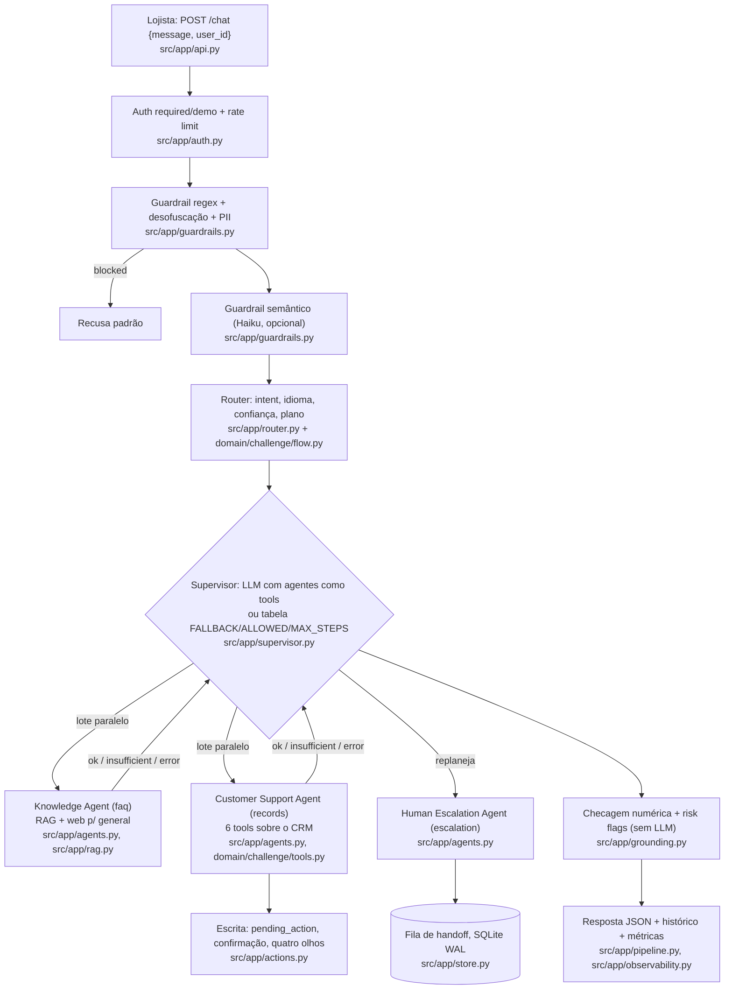
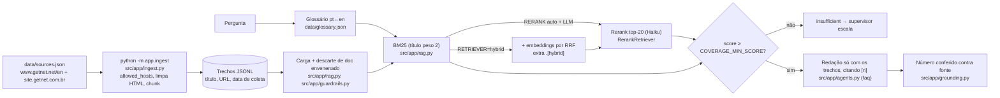
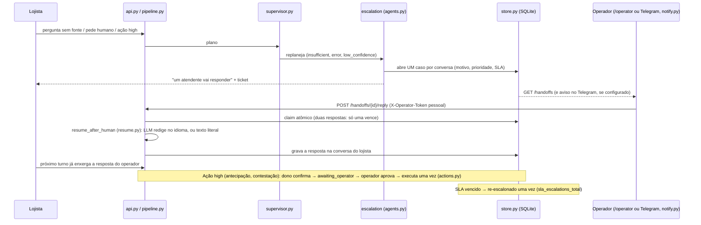

# Arquitetura — Getnet Support Agents

Visão de engenharia do que existe no código. Contrato, requisitos e cenários estão em [SPEC.md](SPEC.md);
decisões em [adr/](adr/). Cada caixa dos diagramas aponta o arquivo que a implementa.

## 1. Fluxo de agentes num turno

Exemplos dos cenários: AC-03 (`support`) → Customer Support → `get_settlements`. AC-05 (`troubleshoot`) →
Customer Support (`get_terminal_status`) e depois Knowledge com o estado da maquininha (`DEPENDS`). AC-02
(`general`) → Knowledge com busca web, nunca escala (`NO_ESCALATION`). Pergunta sem fonte → Knowledge devolve
`insufficient` → supervisor replaneja para Human Escalation.

## 2. RAG: ingestão → armazenamento → busca → geração

## 3. HITL: handoff → operador → retomada

## 4. Componentes

| Componente | Arquivo | Responsabilidade | LLM |
|---|---|---|---|
| API HTTP | `src/app/api.py` | `/chat`, `/actions/*`, `/handoffs/*`, `/operator`, `/feedback`, `/analytics`, `/health`, `/metrics`, `/telegram/webhook` | não |
| Identidade | `src/app/auth.py` | JWT HS256 (`sub`, `exp`, `iss`, `aud`, `jti`), revogação, `AUTH_MODE` required/demo, chave por operador | não |
| Guardrails | `src/app/guardrails.py` | regex, desofuscação, PII, injeção indireta; camada semântica | Haiku (opcional) |
| Router | `src/app/router.py` + `src/app/domain/challenge/flow.py` | intent, idioma, confiança, plano; regras + k-NN offline | Haiku |
| Supervisor | `src/app/supervisor.py` | executa e replaneja dentro de `ALLOWED`/`MAX_STEPS`, lotes paralelos | Sonnet (effort low) |
| Agentes | `src/app/agents.py` | Knowledge (`faq`), Customer Support (`records`), Human Escalation (`escalation`) | Sonnet (effort medium) |
| RAG | `src/app/rag.py`, `src/app/ingest.py` | ingestão, BM25/híbrido, rerank, Recall@k/MRR | rerank (Haiku) |
| Ferramentas | `src/app/tools.py`, `src/app/domain/challenge/tools.py` | 6 tools do CRM fictício, JSON Schema | não |
| Ações | `src/app/actions.py` | `pending_action`, TTL, confirmação, quatro olhos, execução única | não |
| Grounding | `src/app/grounding.py` | número sem base e flags de risco | não |
| Estado | `src/app/store.py` | SQLite WAL: histórico, resumo rolante, memória, tickets, ações, rate limit | não |
| Retomada | `src/app/resume.py` | resposta do operador volta à conversa | Sonnet (opcional) |
| Notificação | `src/app/notify.py` | Telegram ida e volta | não |
| MCP | `src/app/mcp_server.py` | `/mcp` com `ask`, `search_knowledge`, `crm_tool` (JWT obrigatório) | — |
| Observabilidade | `src/app/observability.py`, `src/app/analytics.py` | log JSON com `trace_id`, `/metrics`, custo, OTel opcional, analytics | não |
| Produção | `Dockerfile`, `docker-compose.yml`, `docker-compose.scale.yml`, `ops/lb.py`, `ops/alerts.yml` | imagem não-root, 2 réplicas + balanceador, alertas | — |

Modelos por papel (`src/app/config.py`, sobrescrevíveis por `<PAPEL>_MODEL`/`<PAPEL>_EFFORT`): router e guardrail
Haiku (low), supervisor Sonnet (low), agentes Sonnet (medium), juiz do eval Opus (medium).
